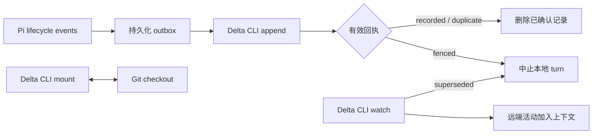

# deltapi

通过 [Delta CLI](https://delta.dev/docs/cli/get-started) 分享和加入 [Pi](https://pi.dev) 编程会话的 Pi extension。`deltapi` 是 Delta 与 Pi 的集成包名。

插件默认不上传任何内容。运行 `/delta share` 并确认后，会话记录和 Git checkout 才会同步到 Delta；协作者的消息在下一次请求时成为模型上下文，不会自动触发工作。协作者接管 turn 时，本地 Pi 会中止执行。

## 安装

需要 Pi **1.4.0 或更新版本**、Node.js **22.19+**，以及支持 recording contract **8** 的 Delta CLI（Delta 0.22.0 引入）。新版本 Delta 仍需包含 contract 8；插件会在连接前检查兼容范围。

先按 [Delta 安装文档](https://delta.dev/docs/cli/get-started#install-delta-cli) 安装 delta.dev 的 CLI，然后登录并选择组织。注意：用于 Git diff 的 `delta` 是另一个同名程序。可以在 Nushell 中为本次环境明确指定路径：

```nu
$env.DELTAPI_CLI = ($env.HOME | path join ".local" "bin" "delta")
^$env.DELTAPI_CLI auth login
^$env.DELTAPI_CLI org list
^$env.DELTAPI_CLI org switch ORGANIZATION_ID
^$env.DELTAPI_CLI --json thread contract
```

在本仓库安装开发依赖，再把目录安装为本地 Pi package：

```nu
cd /home/woxQAQ/deltapi
bun install
pi install /home/woxQAQ/deltapi
```

重新启动 Pi，或执行 `/reload`。也可以只在一次启动中加载：

```nu
pi -e /home/woxQAQ/deltapi/src/index.ts
```

分享时请从 Git checkout 根目录启动 Pi；仓库需要 Git remote。插件通过 Pi 提供的类型和运行时接口加载，无需构建 JavaScript。

## 使用

以下命令在 Pi 内执行：

| 命令 | 行为 |
| --- | --- |
| `/delta` 或 `/delta status` | 查看线程、访问权限与待发送记录数量 |
| `/delta share` | 确认后分享到当前 Delta 组织 |
| `/delta share ada@example.com sam@example.com` | 邀请指定的人；逐项结果会显示在通知中 |
| `/delta share private ORGANIZATION_ID` | 创建仅自己可见的同步会话 |
| `/delta join LINK_OR_THREAD_ID` | 挂载共享文件，在该目录创建并切换到新的 Pi 会话 |
| `/delta reconnect` | 恢复当前绑定，重放待确认记录并重新连接 |
| `/delta unshare` | 取消组织／链接访问；显式邀请的用户保留访问权限 |
| `/delta disconnect` | 停止分享会话的同步，允许本地继续工作，保留线程和待发送记录 |
| `/delta org list` | 列出组织 |
| `/delta org current` | 查看当前组织 |
| `/delta org switch ID` | 切换 Delta 当前组织 |

分享、加入和连接变更需要 Pi 空闲。分享和加入需要能显示确认对话框的 TUI 或 RPC 客户端。不会自动安装 Delta、打开登录页面、更新软件或设置项目级自动上传。

首次分享会导出当前分支中保留的用户消息、assistant 内容（包括 thinking 和图片）及工具输入／输出。之后记录新的完整消息，不发送逐 token 更新。系统提示和其他扩展的自定义消息不导出。

`share private` 只用于创建新的私有同步绑定。已有线程需要先 `/delta unshare` 才能收回组织访问。邀请会保留已有的分享范围，不会将组织共享线程变成仅邀请可见。

断开后继续的本地对话不会在重连时补录；重连会重发已持久化但未确认的记录，再记录新的活动。若需要分享另一段历史，创建新的 Pi 会话。

## 加入与恢复

加入会创建新会话，原会话可以通过 Pi 的 session 功能恢复。加入不会导出原会话、重新分享线程或把原 checkout 附加到共享线程。Pi 使用 session 文件中的工作目录，所有文件工具都在新的 checkout 下运行。joined session 使用临时目录，因此不能用 `/delta disconnect` 原地继续工作；请通过 `/resume` 切回原会话以断开挂载。

恢复已有绑定的 Pi 会话时，插件读取保存的 producer 和 outbox，并重建 watch 快照。远端已交付的内容通过 item ID 和内容 hash 去重；尚未写入 Pi session 的排队消息会在恢复后重新交付。快照优先保留最新约 64,000 字符，单项最多 8,000 字符，并提示如何读取省略历史。远端 thinking 不注入模型上下文；当前版本也不显示远端 thinking。

连接失效或本地 turn 被接管后，插件阻止后续工具调用。取消不能撤销已经完成的文件修改。修复登录、权限或 CLI 问题后执行 `/delta reconnect`。永久错误不会自动重试；CLI 明确标记 `retryable: true` 的错误才会按其重试间隔恢复。

退出、重载或切换 session 时，插件会尝试在 5 秒内排空 outbox，再结束 watch 与 mount。尚未确认的记录保留供下次恢复。Delta 在 mount 退出时完成最后上传；加入时创建的 checkout 随后由 Delta 删除。**Git 忽略的文件和本地分支不被保留**，请不要在临时 checkout 中存放需要长期保留的数据。

## 数据与协议

| 环境变量 | 默认值 | 用途 |
| --- | --- | --- |
| `DELTAPI_CLI` | `delta` | delta.dev CLI 的可执行文件路径，不接受 shell 命令字符串 |
| `DELTAPI_STATE_DIR` | `$XDG_STATE_HOME/deltapi`，未设置时为 `~/.local/state/deltapi` | 本机绑定、序列号、outbox 与交付去重状态 |

状态文件可能包含完整对话、图片和工具输出，以 `0600` 权限写入独立的状态目录。不要把这个目录提交到 Git。线程身份使用固定 `source=pi` 和 Pi session ID 组成的 producer（记录来源身份）。同一 producer 的状态只能由一个进程持有，避免并发复用序列号。

每条记录先写入磁盘再调用 `thread append`。插件逐条发送，以便准确处理确认和部分成功；只有匹配线程、序列号和 turn 的 `recorded`、`duplicate` 或 `fenced` 回执才会删除记录。`fenced` 表示该旧 turn 的内容未写入线程，同时要求本地停止。

若状态文件丢失、损坏，或 Delta 的序列号与本地记录不一致，请恢复匹配的状态，或创建新的 Pi 会话。不要手工重置 `next`，也不要删除 outbox 后复用原 session ID。



当前实现聚焦单个 Pi session 的分享、私有同步和协作加入，不包含 Claude 专属的安装器、自动更新、项目自动同步策略、搜索摘要或 subagent thread 管理。CLI 是唯一的 Delta 数据接口；插件不会读取 Delta 数据库。

## 开发与验证

使用 Bun 管理依赖和运行集成测试，使用 TypeScript 检查类型：

```nu
bun install
just check
just smoke
```

`just smoke` 需要已安装的 `pi`，通过 RPC 验证真实 Pi 能加载插件并注册 `/delta`，不会发送模型请求。集成测试会启动独立的 CLI 模拟进程，覆盖序列确认、丢失回执、接管取消、重连和资源清理，不需要 Delta 账号。

实际 Delta 云端的双机文件交接仍需在支持 contract 8 的 Delta 安装中验证。接口依据、实现取舍和人工验收步骤见 [docs/protocol-notes.md](docs/protocol-notes.md)。

代码为独立实现，使用 MIT 许可证；[delta-claude](https://github.com/zed-industries/delta-claude) 仅作为协议和工作流参考，没有复制其实现代码。
